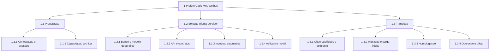
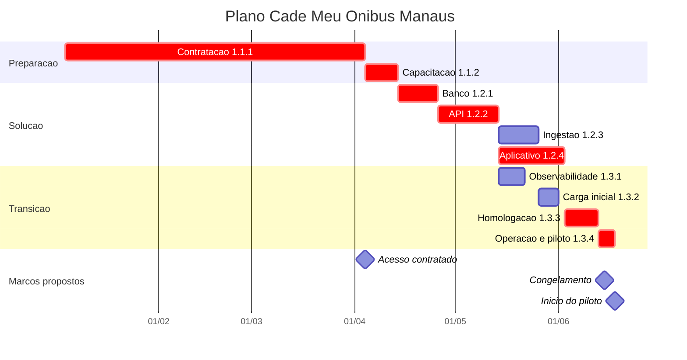

**CIESA — Projetos de Sistemas | Atividade 2NPC - Etapa 2**  
Autor: Roberto Costa. Data: 19/11/2026.

# 2. Entregáveis da Etapa 2

## 2.1 Escopo — a EAP

Legenda: primeiro nível é o projeto; segundo, grupos de entregas; terceiro, pacotes executáveis. As setas indicam decomposição, não dependência temporal.

### Dicionário dos pacotes

| ID | Entrega e aceite | Decisão-origem | Responsável | Depende de | Habilita |
|---|---|---|---|---|---|
| 1.1.1 | Contratos, amostra autorizada, limites de uso e critérios de saída aprovados | ADR-003 e C4 externo | Coordenador/compras | Início e escopo aprovado | 1.1.2 |
| 1.1.2 | Formação de 40 h e exercício com pelo menos 80% dos critérios aprovados | ADR-001/002 e RNF06 | Instrutor e líder técnico | 1.1.1: ferramentas e amostra contratadas | 1.2.1 |
| 1.2.1 | Esquema, índices e relações linha/sentido/parada testados | ADR-002 | Especialista de dados | 1.1.2 | 1.2.2 |
| 1.2.2 | API documentada, componentes detalhados, HTTPS e proteção de favoritos | C4, RF01–RF10, RNF03/04 | Desenvolvedor de API | 1.2.1 | 1.2.3, 1.2.4, 1.3.1 |
| 1.2.3 | Coleta automática, validação temporal e sinalização de idade testadas | ADR-003 e RNF02 | Desenvolvedor de integração | 1.2.2 | 1.3.2 |
| 1.2.4 | App com RF01–RF10 e alternativa textual ao mapa | ADR-001, RNF06/07 | Desenvolvedor móvel | 1.2.2 | 1.3.3 |
| 1.3.1 | Duas instâncias da API, painéis, alarmes e backup configurados | C4 e RNF01/02/05/08 | Operação | 1.2.2 | 1.3.3 |
| 1.3.2 | Importação autorizada reconciliada e procedimento de retorno testado | ADR-002/003 | Especialista de dados | 1.2.3 | 1.3.3 |
| 1.3.3 | Relatório de testes funcionais, carga, segurança, acessibilidade e restauração | C4 e RNF01–RNF08 aplicáveis | Qualidade | 1.2.4, 1.3.1, 1.3.2 | 1.3.4 |
| 1.3.4 | Manual, formação do suporte, exercício de incidente e aceite do piloto | Operação C4 e ADR-003 | Operação e líder | 1.3.3 | Piloto |

Aceite de homologação: aplicar carga de 500 usuários por 15 min 2 s; conferir processamento e idade de RNF02; titularidade, acessibilidade, matriz móvel aprovada e restauração em até 60 min com perda máxima de 15 min. Disponibilidade de 99,5% é medida mensalmente após o piloto: um ensaio curto não comprova esse indicador.

**Pacotes eliminados pelas escolhas:** duas implementações nativas independentes (ADR-001), planilhas operacionais (ADR-002), atualização manual de posições (ADR-003) e compra de servidor físico na alternativa A. Migração significa carga inicial e normalização de dados autorizados, não extração de dados privados do aplicativo existente.

## 2.2 Cronograma e caminho crítico

### Dependências justificadas

| Pacote | Duração | Início relativo | Fim relativo | Folga total | Por que depende do anterior |
|---|---:|---:|---:|---:|---|
| 1.1.1 | 90 | 0 | 90 | 0 | Acesso à fonte exige autorização e contratação. |
| 1.1.2 | 10 | 90 | 100 | 0 | Formação usa amostra e ambientes contratados. |
| 1.2.1 | 12 | 100 | 112 | 0 | Equipe deve dominar o modelo geográfico. |
| 1.2.2 | 18 | 112 | 130 | 0 | API usa esquema e relações do banco. |
| 1.2.3 | 12 | 130 | 142 | 2 | Ingestor usa contratos e repositórios da API. |
| 1.2.4 | 20 | 130 | 150 | 0 | App integrado usa endpoints estáveis. |
| 1.3.1 | 8 | 130 | 138 | 12 | Instrumentação precisa de API executável. |
| 1.3.2 | 6 | 142 | 148 | 2 | Carga usa o adaptador de transporte. |
| 1.3.3 | 10 | 150 | 160 | 0 | Teste ponta a ponta exige app, dados e telemetria. |
| 1.3.4 | 5 | 160 | 165 | 0 | Suporte recebe versão aprovada e procedimentos finais. |

Unidade: dias corridos decorridos desde o início. **Caminho crítico: 1.1.1 → 1.1.2 → 1.2.1 → 1.2.2 → 1.2.4 → 1.3.3 → 1.3.4 = 165 dias.** App, ingestão e observabilidade caminham em paralelo, com pessoas distintas. Especialista de dados atua no banco e depois na carga, sem sobreposição dessas tarefas.

Legenda: barras críticas indicam a cadeia sem folga; as demais são frentes paralelas; marcos têm duração zero. Não se excluem finais de semana porque o prazo é decorrido, não horas de trabalho.

**Marcos imóveis propostos:** piloto em 18/06/2027 e congelamento de versão 72 h antes, em 15/06/2027, após homologação. São restrições hipotéticas a aprovar, não datas impostas pelo PDF. Sem aprovação são datas-alvo. Atraso crítico exige decisão de reduzir escopo com nova rastreabilidade ou adiar o piloto; segurança não é retirada para recuperar prazo. Contratação atrasada é tratada antes de prometer a janela.

## 2.3 Custo em três anos

### Implantação detalhada da alternativa A

| Pacote | Esforço | Tarifa assumida | Custo |
|---|---:|---:|---:|
| 1.1.1 Contratação e acessos | 80 h | R$ 100/h | R$ 8.000 |
| 1.1.2 Capacitação | 40 h | R$ 120/h | R$ 4.800 |
| 1.2.1 Banco | 80 h | R$ 100/h | R$ 8.000 |
| 1.2.2 API | 120 h | R$ 100/h | R$ 12.000 |
| 1.2.3 Ingestão | 80 h | R$ 100/h | R$ 8.000 |
| 1.2.4 Aplicativo | 120 h | R$ 100/h | R$ 12.000 |
| 1.3.1 Observabilidade | 40 h | R$ 100/h | R$ 4.000 |
| 1.3.2 Carga inicial | 40 h | R$ 100/h | R$ 4.000 |
| 1.3.3 Homologação | 80 h | R$ 100/h | R$ 8.000 |
| 1.3.4 Operação e piloto | 24 h | R$ 100/h | R$ 2.400 |
| **Total de trabalho** | **704 h** | | **R$ 71.200** |

Adicionais iniciais: R$ 3.000 para locação de aparelhos/publicação (ADR-001), R$ 2.000 de ambiente de homologação e carga (C4/RNF01) e R$ 1.000 de ativação dos fornecedores (C4 externo). Total inicial A: **R$ 77.200**. Verbas agregadas a cotar, sem duplicação na mensalidade de produção. A tarifa de formação remunera o pacote contratado; a participação dos técnicos é assumida como desenvolvimento interno não faturado à parte neste exercício. Se houver dedicação remunerada adicional, revisar o custo.

### Duas alternativas de implantação do mesmo C4

| Alternativa | Implantação sem reservas | Operação ano 1 | Ano 2 | Ano 3 | Total em 3 anos |
|---|---:|---:|---:|---:|---:|
| A — Nuvem gerenciada | R$ 77.200 | R$ 91.200 | R$ 91.200 | R$ 91.200 | **R$ 350.800** |
| B — Infraestrutura própria | R$ 105.200 | R$ 100.800 | R$ 100.800 | R$ 100.800 | **R$ 407.600** |

Escolha de planejamento: **A**, economia estimada de R$ 56.800 em três anos e menor necessidade de operar hardware. Mantêm-se app, API e PostgreSQL nas duas opções; essa comparação detalha hospedagem do C4, sem substituir os ADRs anteriores.

| Custo mensal | A | B | Premissa e origem |
|---|---:|---:|---|
| Nuvem/banco ou energia/conectividade local | R$ 1.800 | R$ 400 | A: duas instâncias e banco gerenciado; B: hardware comprado; C4/RNF05. |
| Mapas | R$ 600 | R$ 600 | Uma franquia contratual para o recorte; C4 geográfico. |
| Fonte de transporte | R$ 1.000 | R$ 1.000 | Um acesso autorizado; ADR-003. |
| Manutenção e operação | R$ 4.000 | R$ 6.000 | A: 40 h/mês; B: 60 h/mês; R$ 100/h. |
| Backup/monitoramento complementares | R$ 200 | R$ 400 | Complementares ao plano básico; RNF05/08. |
| **Mensal** | **R$ 7.600** | **R$ 8.400** | Multiplicar por 12 em cada ano. |

Implantação B = trabalho R$ 71.200 + aparelhos R$ 3.000 + ambiente R$ 2.000 + ativação R$ 2.000 + hardware redundante R$ 24.000 + instalação física R$ 3.000 = R$ 105.200. Capacidades são hipóteses a testar, não configuração dimensionada comprovada.

Suporte A: 12 h/mês de app, 12 h de API/integração, 8 h de banco e 8 h de monitoramento/atendimento. Não é plantão humano permanente: há alarme automático e escalonamento do fornecedor. Incidentes além da franquia exigem reserva ou mudança aprovada. Os três anos são 36 meses completos após implantação; ambientes anteriores estão no investimento inicial.

### Limites e reservas

Limites hipotéticos do recorte: **R$ 100.000 para implantação com reservas** e **R$ 100.000 anuais de custeio**, sujeitos ao patrocinador. Não são os limites do caso UNIVA do exemplo.

| Componente | Valor |
|---|---:|
| Custo-base A | R$ 77.200 |
| Contingência para riscos identificados | R$ 8.000 |
| Linha de base da implantação | R$ 85.200 |
| Reserva gerencial: 10% da linha de base | R$ 8.520 |
| Autorização total de implantação | **R$ 93.720** |
| Autorização total + 36 meses de operação | **R$ 367.320** |

A cabe nos dois limites. B excede implantação e custeio e exigiria nova autorização. Os TCOs A/B comparam custos sem reservas; reserva é autorização, não gasto obrigatório. Não somar contingência duas vezes. O custeio de A deixa R$ 8.800/ano de margem ao limite para variações, sem presumir contratação automática de excedentes.

## 2.4 Estimativa dos pacotes (PERT)

PERT = (O + 4M + P)/6. Desvio aproximado = (P − O)/6. Valores em dias corridos decorridos. As horas da seção 2.3 são esforço, não conversão direta de duração. Intervalos simétricos simplificam a primeira estimativa e devem ser refinados após conhecer equipe e amostra.

| Pacote | O | M | P | PERT | Desvio | Premissa e risco da cauda pessimista |
|---|---:|---:|---:|---:|---:|---|
| 1.1.1 Contratação | 60 | 90 | 120 | 90 | 10,00 | Um ciclo contratual; negociação/impugnação amplia prazo (R01). O cenário 60 não reduz a janela de 90 adotada no exercício. |
| 1.1.2 Capacitação | 6 | 10 | 14 | 10 | 1,33 | 40 h e exercício; lacuna de competência exige reforço (R03). |
| 1.2.1 Banco | 8 | 12 | 16 | 12 | 1,33 | Uma rede municipal; relações inconsistentes geram revisão (R04). |
| 1.2.2 API | 12 | 18 | 24 | 18 | 2,00 | Um servidor modular; correção de autorização amplia prazo (R06). |
| 1.2.3 Ingestão | 6 | 12 | 18 | 12 | 2,00 | Um fornecedor; mudança de formato ou medições fora de ordem (R02). |
| 1.2.4 Aplicativo | 12 | 20 | 28 | 20 | 2,67 | Uma base Flutter; plugin/acessibilidade exige retrabalho (R03). |
| 1.3.1 Observabilidade | 4 | 8 | 12 | 8 | 1,33 | Um ambiente; backup e alarmes precisam de ajustes (R05). |
| 1.3.2 Carga inicial | 2 | 6 | 10 | 6 | 1,33 | Uma carga e reconciliação; erro de sentido exige repetição (R04). |
| 1.3.3 Homologação | 6 | 10 | 14 | 10 | 1,33 | Matriz funcional e RNFs; falha de carga ou segurança requer reteste (R05/06). |
| 1.3.4 Transição | 3 | 5 | 7 | 5 | 0,67 | Um grupo de suporte; exercício de incidente precisa de repetição (R03). |

Exemplo do app: (12 + 4×20 + 28)/6 = 20 dias; desvio = 16/6 = 2,67 dias. As médias alimentam o Gantt. Na cadeia crítica, soma O/M/P = **107/165/223 dias**. Assumindo independência, desvio agregado é aproximadamente 10,81 dias; faixa média ± dois desvios: cerca de **143–187 dias**. É análise indicativa, não garantia estatística: riscos correlacionados e troca do caminho crítico podem ampliar o prazo. A janela de 165 dias não tem buffer adicional.

A contratação mantém 90 dias na linha de base. O otimista de 60 representa uma hipótese favorável para análise, não dispensa etapas legais nem antecipa o cronograma aprovado abaixo da premissa do exercício.

## 2.5 Riscos

| ID | Risco e origem | Origem arquitetural | Resposta planejada e dono | Gatilho objetivo | Probabilidade × impacto financeiro |
|---|---|---|---|---|---|
| R01 | Acesso/contrato atrasado; projeto | ADR-003 e C4 externo | Mitigar: especificação e negociação cedo; coordenador escala e renegocia piloto | Dia 60 sem fornecedor habilitado ou contrato de dados negociado | 30% × R$ 8.000 = R$ 2.400 |
| R02 | Fonte antiga ou formato alterado; arquitetural | ADR-003 | Mitigar: adaptador e validação temporal; integração ajusta sem inventar previsão | Mais de 5% das posições recebidas com idade acima de 120 s por 10 min, ou contrato de dados quebrado | 25% × R$ 6.000 = R$ 1.500 |
| R03 | Competência insuficiente; equipe | ADR-001/002 | Mitigar: formação e mentoria; líder bloqueia tarefa dependente sem exercício aprovado | Menos de 80% dos critérios do exercício atendidos no fim da formação | 20% × R$ 8.000 = R$ 1.600 |
| R04 | Associação linha/parada incorreta; arquitetural | ADR-002 | Mitigar: reconciliação e carga isolada; dados rejeita registro e pede correção à fonte | Uma previsão com parada fora do itinerário na homologação | 20% × R$ 4.000 = R$ 800 |
| R05 | Desempenho ou recuperação insuficiente; arquitetural | ADR-002 e C4 | Mitigar: índices, capacidade e restauração ensaiada; operação e qualidade repetem testes | p95 acima de 2 s no teste ou recuperação acima de 60 min | 20% × R$ 6.000 = R$ 1.200 |
| R06 | Acesso a favorito alheio; arquitetural | C4 e RNF04 | Mitigar: titularidade e armazenamento seguro; API corrige, qualidade bloqueia liberação | Uma leitura ou alteração entre instalações distintas bem-sucedida em teste | 10% × R$ 5.000 = R$ 500 |
| **Total esperado** | | | | | **R$ 8.000** |

Impactos correspondem a 40–80 h adicionais a R$ 100/h, incluindo apoio contratual em R01. Probabilidades são hipóteses de avaliação inicial, não frequências medidas. Riscos reduzidos: indisponibilidade de cada chamada à fonte pela cópia local; inconsistência pela integridade do banco; duplicação de desenvolvimento pelo app compartilhado. Riscos criados: dado envelhecido, dependência externa e formação especializada.

**Contingência:** R$ 8.000 dentro da linha de base, para os riscos identificados, mediante evento registrado e alçada do coordenador. A soma de valores esperados não cobre todos os eventos simultaneamente; se impactos excederem o saldo, replanejar e pedir autorização.

**Gerencial:** R$ 8.520 fora da linha de base, sob o patrocinador, para imprevistos do objetivo aprovado. Novo escopo exige controle de mudança, não uso automático da reserva. Contingência e gerencial não são intercambiáveis sem autorização.

**Prazo:** folgas de 2 dias na cadeia ingestão/carga e 12 na observabilidade não são dinheiro nem buffer crítico. Atraso na cadeia crítica dispara revisão do marco.

## 2.6 Aquisições

### 2.6.1 Regime e prazo

Adota-se **90 dias corridos** de preparação, seleção, contratação e acesso para o cenário público pedido pelo exercício. A Lei 14.133/2021 tem prazos diferentes conforme objeto e procedimento; não estabelece um mínimo universal de 90 dias para toda contratação. Aqui, 90 dias são a premissa prática do enunciado. A aplicabilidade ao contratante e o procedimento concreto dependem de validação jurídica. Fontes oficiais: [Lei 14.133/2021](https://www.planalto.gov.br/ccivil_03/_ato2019-2022/2021/lei/l14133.htm) e [TCU — apresentação de propostas](https://licitacoesecontratos.tcu.gov.br/5-2-apresentacao-de-propostas/).

Planejar 20 dias de especificação/estudo, 40 de seleção/esclarecimentos, 20 de formalização e 10 de habilitação técnica. São janelas estimadas, não transcrição dos prazos legais de uma modalidade. Mapas, fonte, nuvem e formação são frentes paralelas nessa janela, sem pressupor um contrato único para objetos distintos.

| Objeto | Construir ou comprar e motivo | Prazo | Critério |
|---|---|---|---|
| App e API | Construir: regras e experiência do recorte | 1.2.2 e 1.2.4 | Código e contratos documentados sob controle do projeto. |
| Modelo e importação | Construir sobre PostgreSQL/PostGIS | 1.2.1 e 1.3.2 | Exportação aberta e restauração ensaiada. |
| Rede e posições | Contratar acesso autorizado, sem implantar GPS em frota | Janela de 90 dias | Amostra, direito de uso, limites, instantes de medição e aviso de mudança; validar frequência de 15 s. |
| Mapas/geocodificação | Contratar, sem mapear a cidade do zero | Paralelo nos 90 dias | Franquia e excedentes, apresentação e substituição de fornecedor. |
| Nuvem/banco | Contratar operação gerenciada | Paralelo nos 90 dias | SLA compatível, duas instâncias, backup, exportação e suporte. |
| Formação e dispositivos | Contratar para suprir lacuna | Contratar nos 90 dias; formar em 10 dias decorridos | Curso de 40 h, exercício de aceite e Android/iPhone para teste. |

### Quanto custa sair

| Dependência | Prazo técnico após novo acesso | Estimativa de saída | O que reescrever ou refazer |
|---|---|---|---|
| Nuvem | 10 dias decorridos | 40 h × R$ 100 + R$ 1.000 de ambiente duplicado = R$ 5.000 | Implantação, rede, segredos, restauração e teste; sem reescrever regras/app. |
| Mapas | 8 dias decorridos | 32 h × R$ 100 = R$ 3.200 | Adaptador geográfico, atribuição e apresentação; testar proximidade e viagens. |
| Fonte de transporte | 20 dias decorridos | 80 h × R$ 100 + R$ 2.000 de ativação/teste = R$ 10.000 | Adaptador, identificadores e validação de previsões, se existir substituto autorizado. |

Nova contratação pode acrescentar outra janela de 90 dias ao prazo técnico. Sem fonte alternativa autorizada, não existe saída imediata: manter somente programação identificada como tal, suspender previsão e renegociar a dependência. Valores de saída não são gasto obrigatório no TCO; entram no orçamento somente por evento e mudança aprovados.

## 2.7 Recursos humanos

| Papel | Pacotes e disponibilidade planejada | Quem opera depois |
|---|---|---|
| Coordenador/compras | 1.1.1, 80 h; alçadas e fornecedores | Encaminha contratos e mudanças ao patrocinador. |
| Líder técnico/desenvolvedor de API | 1.2.2, 120 h; acompanha formação e contratos | API e segurança, dentro do suporte. |
| Especialista de dados | 1.2.1, 80 h; 1.3.2, 40 h, em períodos distintos | Modelo, índices, qualidade e recuperação. |
| Desenvolvedor de integração | 1.2.3, 80 h; distinto do desenvolvedor móvel | Adaptador da fonte. |
| Desenvolvedor móvel | 1.2.4, 120 h | App, versões e publicação. |
| Responsável por operação | 1.3.1, 40 h; 1.3.4, 24 h compartilhadas | Alarmes, incidentes, backup e nuvem. |
| Analista de qualidade | 1.3.3, 80 h | Revalidação após mudanças. |
| Instrutor | 1.1.2, 40 h contratadas | Apoio pontual, sem dependência permanente. |

Papéis não significam contratações integrais durante 165 dias. Colaborações remuneradas cabem nas horas de cada pacote ou exigem revisão. Integração, app e observabilidade precisam de executores distintos durante o paralelismo. O trabalho da disciplina é individual; esta é a equipe proposta para executar o projeto.

**Competência ausente:** domínio conjunto de PostGIS e acessibilidade móvel. Pacote 1.1.2: 40 h, R$ 4.800, 10 dias decorridos, no caminho crítico antes do banco. Resultado inferior a 80% aciona reforço e reestimativa. Presença no curso não comprova competência.

**Brooks:** se o app atrasar, inserir nova pessoa demanda treinamento e consome tempo do especialista. Primeiro diagnosticar bloqueio, rever escopo e marco; ampliar equipe só para trabalho divisível e com custo de integração explícito.

**Conway:** para não criar interfaces isoladas por equipe, manter contrato de dados e erros no repositório, duas revisões semanais app/API e uma revisão semanal dados/ingestão/operação. Coordenação cabe no esforço dos pacotes; não é pacote sem origem arquitetural.

**Aceite operacional:** designar titular e substituto de API, banco e operação durante a preparação e confirmar na transição. Não inventar nomes de funcionários: a tabela nomeia papéis, e o patrocinador precisa designar as pessoas antes do piloto. Manuais, alarmes, acesso, backup e exercício de incidente são condição de passagem para operação.