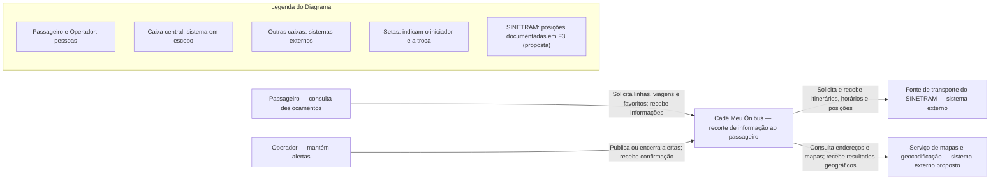
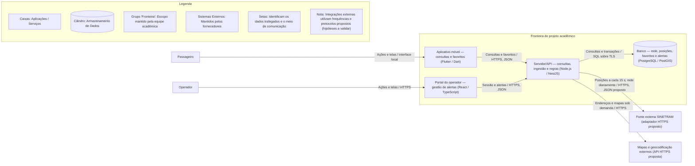
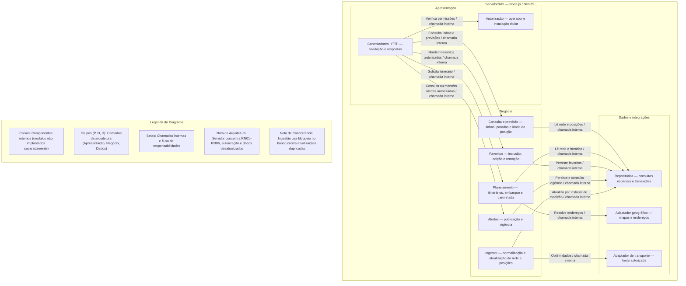
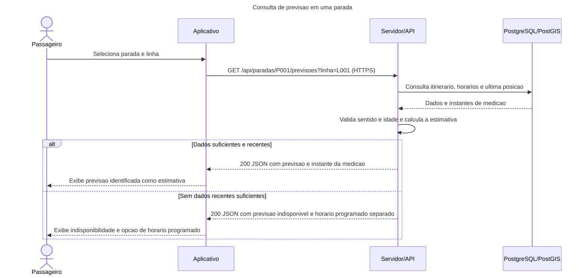

# Atividade Projeto de Sistema 2 NPC - Cadê Meu Ônibus Manaus

## Parte 1 — Requisitos

## 1.1 Delimitação e descrição do sistema

Trabalho acadêmico baseado no software publico Cadê Meu Ônibus de Manaus. O aplicativo informa passageiros sobre linhas, paradas e deslocamentos. Este aplicativo operacionaliza consulta de transporte, planejamento de viagens, favoritos e alertas. Os usuários são o passageiro e como papel proposto para a solução, o operador de informações. 


### 1.2 Requisitos funcionais

| Código | Tipo | Descrição | Prioridade |
|---|---|---|---|
| RF01 | Funcional | O sistema deve permitir que o passageiro pesquise linhas por número ou nome. | Alta |
| RF02 | Funcional | O sistema deve permitir que o passageiro consulte o itinerário e as paradas de uma linha. | Alta |
| RF03 | Funcional | O sistema deve permitir que o passageiro localize paradas próximas informando uma posição ou autorizando a localização do aparelho. | Alta |
| RF04 | Funcional | O sistema deve permitir que o passageiro consulte previsões de chegada em uma parada. | Alta |
| RF05 | Funcional | O sistema deve permitir que o passageiro visualize posições atualizadas dos veículos de uma linha. | Alta |
| RF06 | Funcional | O sistema deve permitir que o passageiro consulte horários programados de uma linha por dia. | Alta |
| RF07 | Funcional | O sistema deve permitir que o passageiro planeje uma viagem informando origem, destino e horário desejado. | Alta |
| RF08 | Funcional | O sistema deve permitir que o passageiro salve uma linha, parada ou viagem como favorito neste aparelho. | Média |
| RF09 | Funcional | O sistema deve permitir que o passageiro altere o nome de um favorito neste aparelho. | Média |
| RF10 | Funcional | O sistema deve permitir que o passageiro remova um favorito neste aparelho. | Média |


### 1.3 Requisitos não funcionais

| Código | Tipo / categoria | Descrição e critério mensurável | Prioridade |
|---|---|---|---|
| RNF01 | Não funcional / desempenho | Consultas de linhas e previsões devem responder em até 2 s em 95% das requisições, em teste de 15 min com 500 usuários simultâneos e dados representativos. | Alta |
| RNF02 | Não funcional / atualização | Com a fonte disponível e atualizada, 95% das posições recebidas devem estar consultáveis em até 30 s após sua recepção; posições com mais de 120 s desde a medição devem ser sinalizadas como desatualizadas. | Alta |
| RNF03 | Não funcional / segurança | 100% das comunicações entre clientes, servidor e serviços externos devem usar HTTPS com TLS 1.2 ou superior, verificado por inspeção de configuração e tráfego de teste. | Alta |
| RNF04 | Não funcional / segurança | 100% das tentativas de publicar alertas sem perfil de operador e de acessar favoritos de outra instalação devem ser negadas em testes de autorização. | Alta |
| RNF05 | Não funcional / disponibilidade | A API de consultas deve atingir 99,5% de disponibilidade mensal, incluindo manutenção, medida por verificação externa a cada minuto. | Alta |
| RNF06 | Não funcional / acessibilidade | Pesquisa, previsão e favoritos devem cumprir os critérios aplicáveis A e AA da WCAG 2.2, mediante avaliação manual e automática; as tarefas devem ser concluídas com TalkBack e VoiceOver sem depender exclusivamente do mapa. | Alta |
| RNF07 | Não funcional / compatibilidade | Os fluxos RF01–RF10 devem passar em Android 12 a 16 e iOS 17 a 19, em aparelho ou emulador, nas larguras lógicas de 360 e 430 pixels, sem corte de controles. | Média |
| RNF08 | Não funcional / recuperação | Em ensaio trimestral de falha do banco, restaurar serviço em até 60 min, com perda máxima de 15 min de dados persistidos; posições podem ser recompostas pela fonte. | Alta |


### 1.4 Regras de negócio

| Código | Tipo | Descrição | Prioridade |
|---|---|---|---|
| RN01 | Regra de negócio | Uma linha pode ter itinerários distintos por sentido; informações de viagem devem identificar o sentido correspondente. | Alta |
| RN02 | Regra de negócio | Um horário programado não equivale a uma previsão de chegada e não pode ser anunciado como medição em tempo real. | Alta |
| RN03 | Regra de negócio | Uma previsão de passagem de uma linha em uma parada só é válida se a parada pertencer ao itinerário e sentido informados. | Alta |
| RN04 | Regra de negócio | Um alerta operacional só é vigente entre seu início e fim de validade, salvo encerramento antecipado pelo operador. | Alta |
| RN05 | Regra de negócio | O planejamento de viagem só pode indicar embarque e desembarque em paradas atendidas pelo itinerário considerado. | Alta |
| RN06 | Regra de negócio | Horários de operação e mensagens ao passageiro são interpretados no horário local de Manaus. | Alta |


## Parte 2 — Documento de arquitetura

### 2.1 Diagramas C4 (Níveis 1 a 3)

### 2.1.1 C4 Nível 1 — Contexto




### 2.1.2 C4 nível 2 — Contêineres




### 2.1.3 C4 nível 3 — Componentes do servidor/API




## 2.2 Três ADRs

### ADR-001 — Oferecer um aplicativo para Android e iPhone

Status: proposta. Data: 2026-11-06.

**Contexto:** os passageiros precisam consultar informações durante seus deslocamentos (RF01–RF10). A interface precisa ser acessível (RNF06) e funcionar nos aparelhos definidos em RNF07.

**Alternativas consideradas:**

- **A — Aplicativo instalado no celular:** facilita o acesso à localização e aos recursos do aparelho. Em contrapartida, precisa ser instalado e atualizado.
- **B — Site acessado pelo navegador:** abre por um link, sem instalação. Em contrapartida, depende das diferenças entre navegadores e oferece uma experiência menos integrada aos recursos do aparelho.

**Decisão:** escolher um aplicativo para Android e iPhone, porque o uso principal acontece no celular durante os deslocamentos. A implementação proposta usa Flutter, conforme o diagrama de contêineres. Acessibilidade e compatibilidade devem ser verificadas nos testes de RNF06 e RNF07.

**Consequências positivas:** acesso pelo ícone do aparelho e integração com localização e leitores de tela.

**Consequências negativas:** ocupa espaço, exige instalação e precisa de atualizações nas lojas. Consultas atualizadas continuam dependendo de internet.

**Quando revisar:** se a instalação se tornar uma barreira para os passageiros ou os testes de acessibilidade e compatibilidade não forem atendidos.

### ADR-002 — Guardar as informações em um banco de dados

Status: proposta. Data: 2026-11-06.

**Contexto:** linhas, paradas, horários e favoritos precisam ser organizados e consultados (RF02, RF03, RF06 e RF08–RF10). As consultas devem cumprir RNF01, e os dados precisam ser recuperáveis conforme RNF08.

**Alternativas consideradas:**

- **A — Banco de dados:** permite organizar registros relacionados e atender vários acessos ao mesmo tempo. Em contrapartida, exige configuração, manutenção e cópias de segurança.
- **B — Arquivos ou planilhas no servidor:** são simples para começar e visualizar pequenas listas. Em contrapartida, alterações simultâneas e relações entre linhas, sentidos e paradas ficam mais difíceis de controlar.

**Decisão:** escolher um banco de dados, porque o sistema precisa consultar e atualizar informações relacionadas com vários usuários. A tecnologia proposta é PostgreSQL, com o recurso geográfico PostGIS para localizar paradas próximas. Índices ajudam nas consultas de RNF01, enquanto cópias de segurança e recuperação pontual apoiam RNF08.

**Consequências positivas:** informações centralizadas, consultas organizadas e melhor controle das relações entre linhas e paradas.

**Consequências negativas:** há custo de manutenção e armazenamento; uma falha no banco pode interromper consultas até a recuperação.

**Quando revisar:** se as consultas ultrapassarem o tempo de RNF01 ou a recuperação ultrapassar os limites de RNF08, mesmo após ajustes de configuração.

### ADR-003 — Atualizar automaticamente as posições dos ônibus

Status: proposta. Data: 2026-11-06.

**Contexto:** o passageiro precisa consultar a previsão de chegada e a posição dos veículos (RF04 e RF05). RNF02 exige controle de atualização, e RN02 impede confundir previsão com horário programado.

**Alternativas consideradas:**

- **A — Atualização automática pelo servidor:** busca periodicamente os dados da fonte de transporte e os disponibiliza aos passageiros. Em contrapartida, consome conexão e depende da disponibilidade e autorização do fornecedor.
- **B — Atualização manual pelo operador:** permite conferir cada informação antes de publicá-la. Em contrapartida, exige trabalho contínuo e não acompanha adequadamente o movimento dos ônibus.

**Decisão:** escolher atualização automática. O servidor propõe buscar posições a cada 15 segundos, sujeito aos limites e à autorização da fonte, e guardar a última posição recebida para as consultas. O aplicativo informa o horário da medição e sinaliza posições com mais de 120 segundos, conforme RNF02. Quando não houver dados suficientes, mostra que a previsão está indisponível e apresenta o horário programado separadamente.

**Consequências positivas:** reduz o trabalho manual e permite atender consultas com a última informação disponível, apoiando RNF01 e RNF05.

**Consequências negativas:** a posição pode envelhecer entre atualizações; falhas na conexão ou na fonte prejudicam a informação apresentada. Atualização automática não garante precisão absoluta da chegada.

**Quando revisar:** se o fornecedor não autorizar a frequência proposta ou o sistema deixar de cumprir os limites de RNF02.


## 2.3 Comunicação cliente-servidor

### 2.3.1 Sequência — consultar previsão de passagem, RF04



Legenda: pessoa é o passageiro; participantes são unidades executáveis e banco; setas contínuas são chamadas e tracejadas são respostas. A ingestão ocorre previamente, conforme ADR-003. Linha ou parada inexistente resulta em 404. Uma previsão indisponível por ausência de telemetria é um resultado de negócio válido, diferente de falha do servidor.


### 2.3.2 Quatro requisições HTTP

**1 — GET: consultar previsão, RF04**

`GET /api/paradas/P001/previsoes?linha=L001`

Resposta: `200 OK`.

```json
{"paradaId":"P001","linhaId":"L001","sentido":"ida","previsaoMinutos":8,"tipo":"estimativa","medidoEm":"2026-11-06T08:00:00-04:00","desatualizado":false}
```

**2 — POST: criar favorito, RF08**

`POST /api/favoritos`

Corpo:

```json
{"tipo":"linha","referenciaId":"L001","nome":"Linha para o trabalho"}
```

Resposta: `201 Created`, com `Location: /api/favoritos/42`.

```json
{"id":42,"tipo":"linha","referenciaId":"L001","nome":"Linha para o trabalho"}
```

**3 — PUT: alterar favorito, RF09, com erro**

`PUT /api/favoritos/42`

Corpo com todos os campos editáveis:

```json
{"tipo":"linha","referenciaId":"L001","nome":""}
```

Resposta: `422 Unprocessable Content`.

```json
{"erro":"NOME_INVALIDO","mensagem":"Informe um nome entre 1 e 60 caracteres. O favorito foi mantido sem alteração."}
```

Limite de nome é uma validação proposta da interface. Com nome válido, retorna 200 e representação atualizada. Não é regra operacional de transporte.

**4 — DELETE: excluir favorito, RF10**

`DELETE /api/favoritos/42`

Resposta: `200 OK`.

```json
{"id":42,"removido":true}
```


### 2.3.3 HTTPS

Localização consultada, favoritos, trajetos pesquisados, credenciais e sessão do operador precisam de proteção em trânsito. TLS garante confidencialidade, integridade e autenticação do servidor quando o certificado é validado. Não garante sozinho autorização, segurança do aparelho ou proteção de dados armazenados. Complementos propostos: controle de perfil, titularidade por instalação, segredos fora do código e logs sem coordenadas pessoais, senhas ou credenciais. A localização pode ser informada manualmente. Não se armazena histórico pessoal de deslocamento neste recorte. O mapa é servido pelo servidor ou intermediado sem expor segredos do fornecedor ao aplicativo.


## 2.4 Rastreabilidade

### 2.4.1 Todos os RNFs ligados a decisões

| RNF | ADR / C4 | Validação planejada |
|---|---|---|
| RNF01 | ADR-002 e ADR-003: índices espaciais e consulta local | Teste de carga, percentil 95 e dados representativos. |
| RNF02 | ADR-003 e ingestor no C4 nível 3 | Medir tempo entre recepção e disponibilidade; simular fonte atrasada. |
| RNF03 | Ligações HTTPS e SQL sobre TLS no C4 nível 2 | Inspecionar configurações e tráfego em teste. |
| RNF04 | Componente de autorização no C4 nível 3 | Testar publicação sem perfil e troca de ID de favorito entre instalações. |
| RNF05 | Duas instâncias, monitoramento e cópia local no C4 nível 2; ADR-003 | Medir disponibilidade mensal e simular falha de instância e de fonte. |
| RNF06 | ADR-001: aplicativo acessível; alternativa textual ao mapa prevista no projeto | Avaliação automática e manual, TalkBack e VoiceOver. |
| RNF07 | ADR-001: aplicativo Android e iPhone com Flutter | Executar matriz de versões e larguras declaradas. |
| RNF08 | ADR-002 e banco gerenciado do C4 nível 2 | Ensaio trimestral de restauração com registro de RTO e RPO. |


### 2.4.2 Todas as requisições ligadas a RFs

| Requisição | Requisito | Responsável |
|---|---|---|
| GET /api/paradas/P001/previsoes | RF04 | Consulta e previsão |
| POST /api/favoritos | RF08 | Favoritos |
| PUT /api/favoritos/42 | RF09 | Favoritos |
| DELETE /api/favoritos/42 | RF10 | Favoritos |


### 2.4.3 Responsabilidades ligadas às necessidades

| Elemento | Justificativa |
|---|---|
| Aplicativo móvel | RF01–RF10, RNF06 e RNF07 |
| Portal do operador | requisito excluído de publicação de alertas |
| Controladores e autorização | RF08–requisito excluído de publicação de alertas, RNF03 e RNF04 |
| Consulta e previsão | RF01–RF06, RN01–RN03 e RN06 |
| Planejamento e adaptador geográfico | RF03 e RF07, RN05 e RN06 |
| Favoritos | RF08–RF10 |
| Alertas | requisito excluído de consulta de alertas e requisito excluído de publicação de alertas, RN04 |
| Ingestor e adaptador de transporte | RF02–RF07, RNF02 |
| Banco e repositórios | Persistência de RF02–requisito excluído de publicação de alertas, RNF01 e RNF08 |
| Redundância e monitoramento | RNF05 |